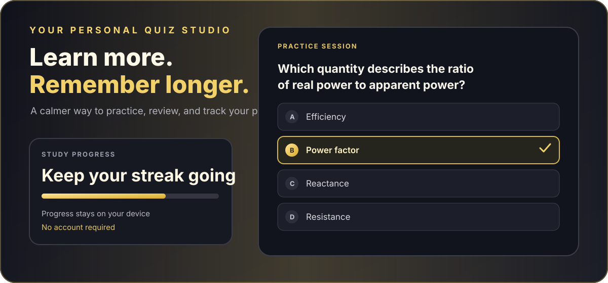

# REEQUIZ

**A simple, polished place to turn quiz files into study sessions.**

REEQUIZ lets you import quizzes, practice at your own pace, review explanations, and keep track of your progress. It works in your browser, keeps your library on your device, and can be installed for offline use.



[Open the live app](https://reequiz-website.vercel.app) · [Browse the source](https://github.com/engrkarlo/reequiz-website)

## What you can do

- **Bring your own quizzes:** Import supported `.quiz` and JSON files, or create a quiz from scratch.
- **Study your way:** Practice mode, timed sessions, shuffled questions and choices, and review of missed questions.
- **Pick up where you left off:** Quiz sessions, answers, preferences, and statistics are saved in your browser.
- **Understand the answers:** Explanations are available when included in a quiz, and the optional AI quiz tutor can check answer keys and prepare explanations.
- **Make it yours:** Choose a light or dark theme, customize quiz profiles, and use the responsive layout on desktop or mobile.
- **Study offline:** After opening the app online once and allowing it to cache, the installed app shell and saved quiz data can be used offline. AI preparation still needs an internet connection.

## Getting started

### Use REEQUIZ

Open the [live app](https://reequiz-website.vercel.app), import a quiz from **My Library**, and start a session. You don't need an account.

### Run it on your computer

You’ll need Node.js 18 or newer.

```bash
npm install
npm run dev
```

To create a production build:

```bash
npm run build
npm run preview
```

## Quiz file formats

REEQUIZ accepts:

- **`.json`** files with a `title` and a `questions` array. Each question can include `question`, `options`, `answer`, and `explanation`.
- **`.quiz`** files using the ZIP-based format supported by the importer, including the `multipleChoiceV2` entries used by the Custom Quiz app.

Not every variation of the `.quiz` format is guaranteed to import cleanly. Check imported questions and correct answers before relying on a quiz for an exam.

## Optional AI quiz tutor

AI preparation is optional. Turn on **AI quiz tutor** in Settings, then choose **AI validate & explain** for a quiz in My Library. The tutor can review answer keys and generate explanations with feedback for each choice. Results are saved with the quiz so prepared explanations can be read offline.

AI responses can be wrong, so review answer-key changes before studying from them. AI preparation itself requires an internet connection.

### Configure AI on Vercel

The AI endpoint uses server-side environment variables. In your Vercel project settings, add:

- `GROQ_API_KEY` — primary provider key.
- `GEMINI_API_KEY` — optional fallback key used when Groq is rate-limited.
- `GROQ_MODEL` — optional model override.
- `GEMINI_MODEL` — optional fallback model override.

Keep provider keys on the server. **Never put API keys in frontend code or in variables prefixed with `VITE_`.** Redeploy after changing environment variables. Model availability and provider limits may change.

## Your data stays local

Imported quizzes, preferences, sessions, statistics, and prepared explanations are stored in your browser. They are not automatically synced between devices. Use the same browser and device to access your saved library, and avoid clearing the site's browser data unless you intend to remove local progress.

## Built with

React · Vite · JavaScript · Vercel

---

Made for more focused practice and less time fighting with quiz files.
