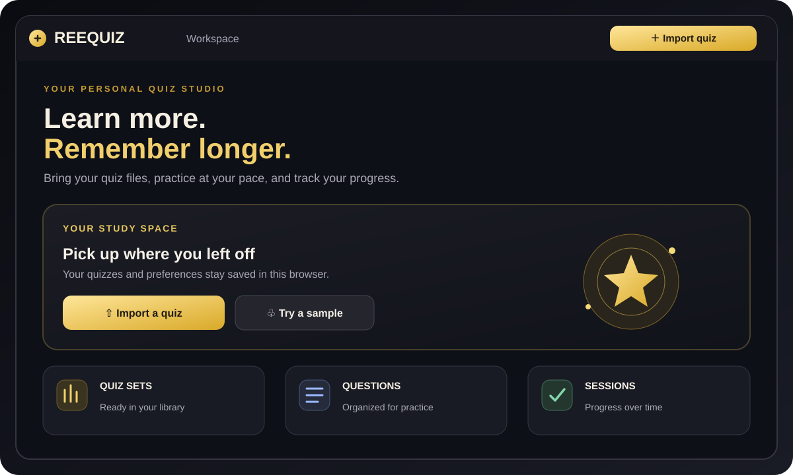
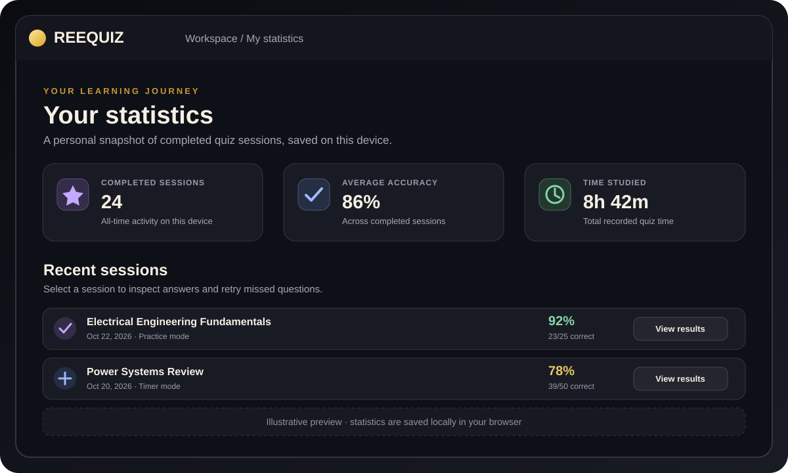
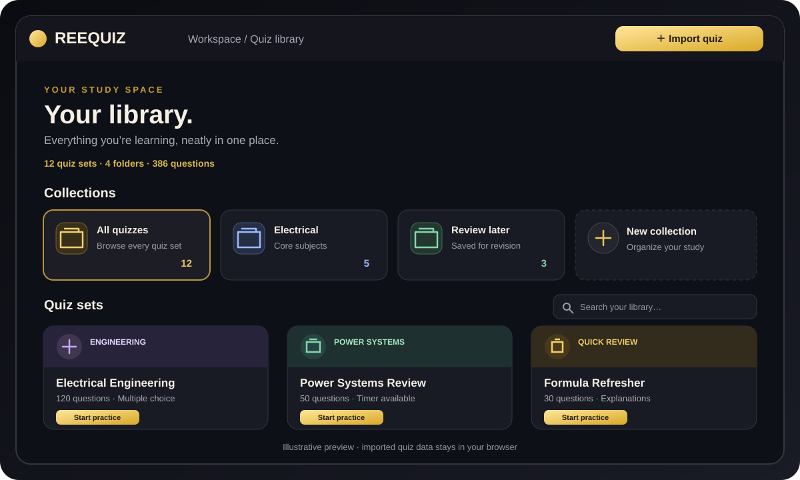

# REEQUIZ

**A simple, polished place to turn quiz files into study sessions.**

REEQUIZ lets you import quizzes, practice at your own pace, review explanations, and keep track of your progress. It runs as a static browser app and stores your library and study progress on your device.

## App showcase

### Overview

### Statistics

### My Library

## What you can do

- **Bring your own quizzes:** Import supported `.quiz` and JSON files, or create a quiz from scratch.
- **Study your way:** Practice mode, timed sessions, shuffled questions and choices, and review of missed questions.
- **Pick up where you left off:** Quiz sessions, answers, preferences, and statistics are saved in your browser.
- **Understand the answers:** Explanations are available when included in a quiz, and the optional AI quiz tutor can check answer keys and prepare explanations.
- **Make it yours:** Choose a light or dark theme, customize quiz profiles, and use the responsive layout on desktop or mobile.

## Open with Acode Live Server (no Vite)

1. Open the repository folder itself in Acode.
2. Start **Acode Live Server** from the project root — the folder containing `index.html`.
3. Keep the device connected to the internet on first load. The static loader fetches React, ReactDOM, Babel, fflate, and Lucide from public CDNs, then compiles the existing JSX in the browser. No Node.js, `npm install`, Vite server, or build step is needed.
4. Refresh the preview after editing files. The loader fetches `src/main.jsx` without using the browser cache.

**Important:** This is a static preview workflow, not a bundled/offline-first build. The first load needs internet access for the CDN libraries. The optional AI quiz tutor still requires its configured `/api/ai-import` endpoint; a plain static server does not provide that API by itself.

## Quiz file formats

- **`.json`** files with a `title` and a `questions` array. Each question can include `question`, `options`, `answer`, and `explanation`.
- **`.quiz`** files using the ZIP-based format supported by the importer, including the `multipleChoiceV2` entries used by the Custom Quiz app.

Not every variation of the `.quiz` format is guaranteed to import cleanly. Check imported questions and correct answers before relying on a quiz for an exam.

## Optional AI quiz tutor

AI preparation is optional. Turn on **AI quiz tutor** in Settings, then choose **AI validate & explain** for a quiz in My Library. The tutor can review answer keys and generate explanations with feedback for each choice. Results are saved with the quiz so prepared explanations can be read later.

AI responses can be wrong, so review answer-key changes before studying from a quiz. AI preparation requires an internet connection and a configured server endpoint. Keep provider API keys on the server; never put API keys in frontend code.

## Your data stays local

Imported quizzes, preferences, sessions, statistics, and prepared explanations are stored in your browser. They are not automatically synced between devices. Use the same browser and device to access your saved library, and avoid clearing the site's browser data unless you intend to remove local progress.

## Built with

React · JSX compiled in-browser with Babel Standalone · Static HTML/CSS/JavaScript

---

  
   
  Copyright © 2026 Orion Hub Development. All rights reserved.

