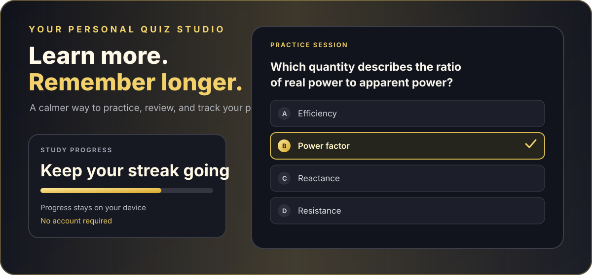
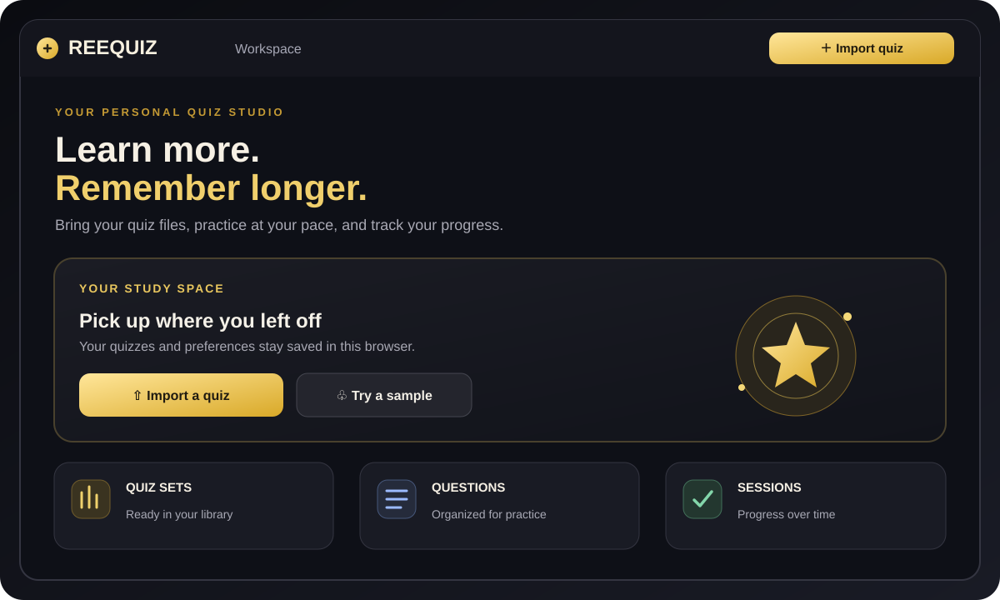
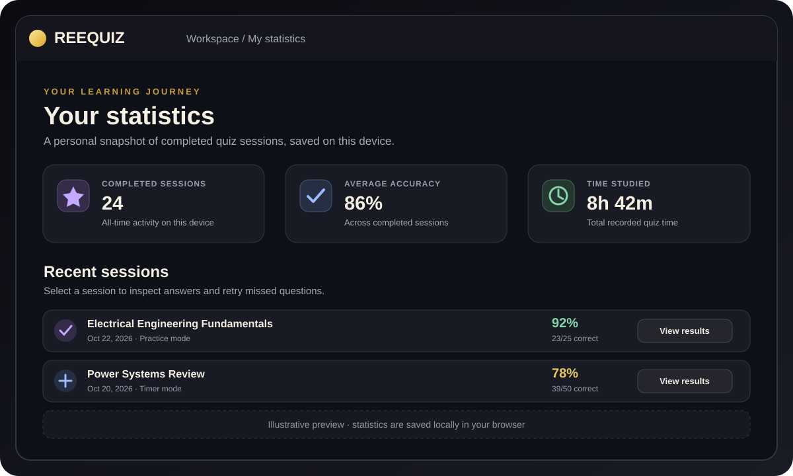
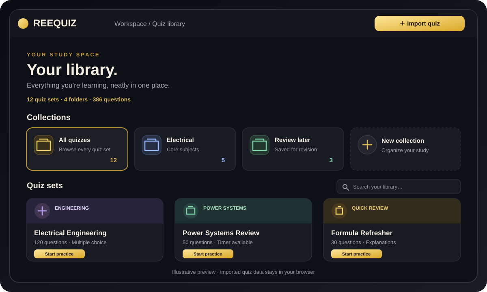

# REEQUIZ

**A simple, polished place to turn quiz files into study sessions.**

REEQUIZ lets you import quizzes, practice at your own pace, review explanations, and keep track of your progress. It works in your browser, keeps your library on your device, and can be installed for offline use.



## App showcase

The SVG previews below illustrate the three main workspace tabs, based on the current app UI. They are lightweight, scalable images that render directly on GitHub.

### Overview

Your starting point for importing quizzes, jumping into study, and getting a quick snapshot of your workspace.



### Statistics

Review completed sessions, average accuracy, total study time, recent results, and answer reviews.



### My Library

Keep quiz sets organized into collections, search your library, and launch practice sessions.




## What you can do

- **Bring your own quizzes:** Import supported `.quiz` and JSON files, or create a quiz from scratch.
- **Study your way:** Practice mode, timed sessions, shuffled questions and choices, and review of missed questions.
- **Pick up where you left off:** Quiz sessions, answers, preferences, and statistics are saved in your browser.
- **Understand the answers:** Explanations are available when included in a quiz, and the optional AI quiz tutor can check answer keys and prepare explanations.
- **Make it yours:** Choose a light or dark theme, customize quiz profiles, and use the responsive layout on desktop or mobile.
- **Study offline:** After opening the app online once and allowing it to cache, the installed app shell and saved quiz data can be used offline. AI preparation still needs an internet connection.

## Getting started

### Use REEQUIZ

Run REEQUIZ locally using the steps below, import a quiz from **My Library**, and start a session. You don't need an account.

### Run it on your computer

You’ll need Node.js 20 or newer (Node.js 22 recommended for deployment).

```bash
npm install
npm run dev
```

To create a production build:

```bash
npm run build
npm run preview
```

## Quiz file formats

REEQUIZ accepts:

- **`.json`** files with a `title` and a `questions` array. Each question can include `question`, `options`, `answer`, and `explanation`.
- **`.quiz`** files using the ZIP-based format supported by the importer, including the `multipleChoiceV2` entries used by the Custom Quiz app.

Not every variation of the `.quiz` format is guaranteed to import cleanly. Check imported questions and correct answers before relying on a quiz for an exam.

## Optional AI quiz tutor

AI preparation is optional. Turn on **AI quiz tutor** in Settings, then choose **AI validate & explain** for a quiz in My Library. The tutor can review answer keys and generate explanations with feedback for each choice. Results are saved with the quiz so prepared explanations can be read offline.

AI responses can be wrong, so review answer-key changes before studying from them. AI preparation itself requires an internet connection.

### Configure the AI endpoint

The AI endpoint uses server-side environment variables. Configure these in the environment used to host the server endpoint:

- `GROQ_API_KEY` — primary provider key.
- `GEMINI_API_KEY` — second provider key. Used if Groq fails, is unavailable, or reaches its quota; Groq is likewise a fallback when Gemini is primary.
- `GROQ_MODEL` — optional model override.
- `GEMINI_MODEL` — optional model override for Gemini (default: `gemini-2.5-flash`).
- `AI_PRIMARY_PROVIDER` — optional `groq` (default) or `gemini`. The other available provider is automatically tried if the primary fails.
- `AI_PREPARE_PROVIDER` — optional primary-provider override for AI validate & explain.

## Fully offline Quiz Studio scanner

Quiz Studio scans image files (JPG, PNG, WebP, GIF) and PDFs **entirely in your browser**. It uses Tesseract.js with a self-hosted English OCR model and PDF.js to read selectable PDF text directly; image-only PDF pages are rasterized and OCR'd locally. No images, extracted text, questions, or printed answer keys are uploaded to the server, and scanning does not need provider API keys.

**Two-column pages:** the browser detects a mostly empty vertical gutter in a low-resolution preview, recognizes the **left column from top to bottom**, then the **right column**. This prevents a typical two-column exam photo (questions 1–14 on the left, 15–30 on the right) from mixing adjacent questions. Side-by-side A/C and B/D answer choices inside a column are reordered by their printed letters, without shifting the answer key. Single-column pages continue to use normal OCR. Dense handwritten pages, overlapping columns, and unusual layouts may still need manual review.

**Performance:** the WebAssembly OCR worker and English language model are reused between scans in the same browser session, two-column crops use a simpler OCR page-segmentation mode, and large camera photos are resized to a maximum 2,400-pixel edge before recognition. The original-file limit remains 20 MB combined, with a maximum of 25 image/PDF pages per scan and 10 pages per PDF. OCR takes time on mobile devices, particularly the first time its model loads, and no specific speedup is guaranteed on every device.

The app accepts **20 MB of original files combined**, up to **25 images/PDF pages** in one scan, and at most **10 pages per PDF**. It recognizes numbered questions and A–H answer choices, and automatically matches explicit printed answer keys even when the key is in a later PDF page or a **separate uploaded image**. Identical key entries are safe; conflicting keys, duplicate question numbers, missing choices, and unkeyed answers require manual review. The local parser does **not** invent missing answers or choices.

For true offline operation, the OCR JavaScript worker, WebAssembly core variants, English language data, PDF parsing code, and PDF worker are **bundled locally** and precached by the PWA service worker. The user must open the site **once while online and allow its offline installation to finish**; scanning then works without connectivity. Browser storage clearing will require a new download of those assets. OCR accuracy depends on image quality and page layout. English is the packaged recognition language.

`npm install` copies OCR assets from dependencies into `public/ocr/` using the `postinstall` script, and `npm run build` repeats the copy and generates `dist/offline-manifest.json` to precache the Vite chunks. **Do not omit the install/build scripts on deployment**. The generated model and WASM files are intentionally not committed to Git. Use `npm test` to run parser and API regression tests.


### OCR accuracy safeguards (two-column exam photos)

The offline scanner treats all columns of a source image or PDF page as one logical page when detecting an **answer key**. A heading on the left applies to key entries in the right column too. Sparse keys, such as numbered answers 1–51 on the left and 52–100 on the right, are supported, including those without a repeated heading. Repeated uppercase subject headings (for example, **THERMODYNAMICS**) and page footers are excluded from question text and answer choices.

Printed question numbers are audited for gaps and duplicates. Only suspicious columns get a **second, local OCR attempt** using a different Tesseract segmentation mode; improved text is kept only when it recovers more usable questions/key entries. If a numbered question is readable but a choice is missing, the scanner retains that question with explicit OCR placeholders rather than silently omitting it or shifting answer labels. Unrecovered question numbers and incomplete choices are displayed in a persistent review banner. Ambiguous or missing answers always require manual confirmation.

On mobile, the scan button shows a compact loading label and detailed progress appears below it, wrapping safely within the available width. The browser still does all processing locally with no AI service calls. Performance varies by hardware; the extra OCR pass is **selective**, not applied to every page.


### Two-column answer-key photo and question 16 reliability

Some exam pages have broad columns of questions but an answer-key sheet contains **two very narrow numbered lists**. An earlier half-page crop and Tesseract PSM 4 could miss virtually all keys in the left list. The scanner now detects narrow ink strips independently of the standard question-column layout and applies **tightly cropped, locally enlarged PSM 6** recognition to each strip. This handles a separately uploaded answer-key photo whose first list runs from 1–51 and second from 52–100. If the printed key does not fully OCR, unmatched answers still require manual confirmation.

OCR sometimes reads side-by-side multiple-choice lines such as \`A. I only C. I and II\` followed by \`B, II only D, Neither I nor II\`. The parser now recognizes both periods **and commas** after choice letters, restoring A/B/C/D ordering before matching the key. A truncated question number (e.g., \`17\` OCR'd as \`7\`) can be repaired only when both adjacent question numbers and an explicit printed answer-key entry agree. Similarly, key-number repairs use neighboring entries and never invent answer letters.

The improved scanner remains fully offline and uses the existing 20 MB upload cap. Regression tests include OCR text transcribed from the supplied thermodynamics photos, the first 30 printed key entries, and narrow key-strip pixel layouts. Actual browser results can still vary with photograph quality, lighting, and OCR engine behavior.

The manual **AI validate & explain** action in My Library remains an optional **online** feature using Groq/Gemini; it is separate from the fully offline Quiz Studio scanner.

Keep provider keys on the server. **Never put API keys in frontend code or in variables prefixed with `VITE_`.** Redeploy after changing environment variables. Model availability and provider limits may change.

## Your data stays local

Imported quizzes, preferences, sessions, statistics, and prepared explanations are stored in your browser. They are not automatically synced between devices. Use the same browser and device to access your saved library, and avoid clearing the site's browser data unless you intend to remove local progress.

## Built with

React · Vite · JavaScript

---

<p align="center">
  
  <br />
  <sub>Copyright © 2026 Orion Hub Development. All rights reserved.</sub>
</p>


### False answer-key questions and manual key identification

The scan now classifies each **source image or PDF page** before creating question-bank entries. A detected narrow printed answer-key layout, a short OCR-damaged heading such as \`ANSWEI\`, or a dense group of numbered answer letters identifies a key-only page. Even if the entire printed key is unreadable, it is **not** added as an extra quiz question (such as a false question 31). OCR key pairs are matched across separate images, and any unreadable key page is reported explicitly.

To override automatic detection for a difficult or unusually formatted answer-key image, select **Mark key** beside that uploaded file before scanning. It is optional: automatic detection remains the default. This setting only affects locally processed scan content and does not send files anywhere. For truly unreadable answer letters, the scanner does not guess and the quiz still requires manual review. A corrupted duplicate number, such as question 17 read as 27, can be repaired only when the surrounding question sequence and printed key support it.

After installing a new deployment, open the site once while online and reload it so the revised offline service-worker cache is installed. Stored OCR engines and PDF models remain local.


### Two-column scan reliability (30 questions + separate marked answer key)

For photographed exam sheets, the offline scanner now recognizes each wide question column with Tesseract **PSM 6** instead of PSM 4. On the supplied thermodynamics page, a local OCR check with PSM 4 detached the left-side question numbers from the stems; PSM 6 kept question numbers **1–14** and **15–30** in reading order. The separate, explicitly marked answer-key photo continues to use local PSM 6 for its narrow columns; correctly read entries are matched by number, while unreadable or ambiguous letters remain unconfirmed.

An OCR fragment consisting of a number and a stem but **no printed answer-choice labels** is no longer imported as a fabricated blank quiz question. Its number is shown in an **Unrecognized question candidates** review warning for rescanning or manual addition. Questions with some, but incomplete, choice text remain editable and unverified. The combined upload limit remains 20 MB; no scanning data is uploaded.

After deploying, open REEQUIZ once while online and reload so the service-worker cache installs the updated scanner. Browser OCR quality may vary by device; the local CLI reproduction is not a guarantee of perfect Android OCR.
